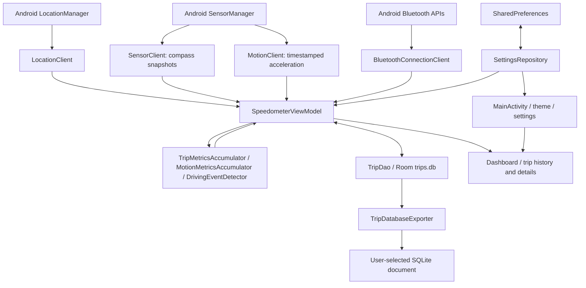

# LibreSpeedo architecture

LibreSpeedo is a single Android app module using Kotlin, Jetpack Compose, Material 3, coroutines/Flow, SharedPreferences, and Room. Location and Bluetooth integration use native Android APIs without Google Play Services. See the [development guide](development.md) for versions and verification.

## Data flow

Sources are under `app/src/main/java/com/plabin/librespeedo/`. `MainActivity` creates the activity-scoped ViewModel, handles permissions and document export, and hosts Compose navigation for dashboard, settings, trip history, about, and license screens.

## Location and compass

`LocationClient.getLocationUpdates()` wraps `LocationManager` callbacks in a `callbackFlow`. It chooses the first enabled provider: native fused on API 31+, then GPS, then network. API 31+ requests use `QUALITY_HIGH_ACCURACY`; older versions use the legacy request overload. Provider/mode broadcasts trigger reselection, and collection waits when no provider is enabled. Closing the flow unregisters callbacks and its receiver. Provider implementation and delivered accuracy depend on the OS/device.

The ViewModel requests a 500 ms interval, tracks location freshness using elapsed realtime, and expires a fix after five seconds. Freshness and speed availability are separate UI flags; a fresh fix need not contain speed. A location permission error invalidates the display and ends an active trip with `PERMISSION_LOST`.

`SensorClient` emits compass-oriented accelerometer, gyro, and magnetic-field snapshots. Accelerometer/magnetic inputs use a low-pass filter with alpha 0.15; gravity orientation drives coordinate remapping for upright use. These snapshots include gravity and are not trip G-force inputs. Heading uses fresh GPS bearing above 3 km/h when present, falling back to compass azimuth otherwise.

## State, dashboard, and lifecycle

`SpeedometerViewModel` exposes `SpeedometerUiState`, `TripLoggerUiState`, ordered widgets, and saved spans. It owns the `SettingsRepository` shared with `MainActivity`, including across activity recreation. The repository exposes SharedPreferences-backed StateFlows updated through its setters, so UI changes reach recorder consumers without restarting. Automation, car selection, and retention are observed live; route storage and mounting confirmation are captured at trip start.

The dashboard has a two-column `LazyVerticalGrid` with half-width, wide, and large cards. Editing supports reordering, widget management, sizing, and style pickers. The Trip logger card is separate from the customizable widget enum. `ChronometerState` belongs to the ViewModel and survives composition changes and rotation, but is neither trip timing nor persistent storage.

`MainActivity.onStart()` marks the app visible and starts permitted location tracking. `onStop()` skips configuration changes; otherwise it stops visible-app motion/Bluetooth observation, finishes the trip as `BACKGROUND`, and stops location/compass tracking. Internal navigation retains the activity/ViewModel. There is no foreground service, boot receiver, closed-app monitoring, or Android Auto UI.

The Material 3 theme defaults to the slate dark palette even when the system requests light mode; an OLED setting switches to black surfaces. Wallpaper dynamic colors default to false, although the theme function supports them as an explicit parameter.

## Trip coordination

Coordination lives in the ViewModel, with a coroutine `Mutex` serializing trip mutations and persistence. It is not yet an independent state-machine/repository layer. `TripStatus` is `RECORDING`, `FINISHED`, or `INTERRUPTED`; movement classification is separately `MOVING`, `STOPPED`, or `UNKNOWN`.

Manual start creates a UUID trip immediately with UTC display timestamps and elapsed-realtime interval anchors. Route storage and mounting confirmation are captured at start. Automatic start additionally requires the selected car to be connected, automation enabled, storage initialization complete, and accepted non-network speed above 8 km/h for five seconds. Candidate gaps must be at most 1.5 seconds; acceptance checks speed or location accuracy. Confirmation commits the buffered candidate once, backdated to its first sample, including available pre-trip motion.

`BluetoothConnectionClient` lists bonded devices and registers address-filtered ACL observation before requesting initial A2DP/HEADSET profile checks. Permission or connection uncertainty is represented as `UNKNOWN`. A selected-car disconnect records a boundary checkpoint and starts a 60-second grace period. Reconnection of that car cancels the timer; expiry finalizes at the boundary and removes later samples/chunks/events. Disabling automation or changing the selected car ends an automatic trip as appropriate.

Checkpoint/finalization transactions run off the UI thread, generally every five seconds as location or motion samples arrive. Persistence failures surface errors and cease claiming an active saved recording. Startup recovers an unfinished recording as `INTERRUPTED`/`RECOVERED` with its end elapsed time set to the last checkpoint. Its end UTC field currently uses recovery wall time, so elapsed anchors, not wall-clock subtraction, define recovered duration.

## Speed and movement metrics

`TripMetricsAccumulator` is pure and replayable over `SpeedObservation`. It rejects duplicate/out-of-order timestamps, applies an isolated high-speed jump gate, and integrates adjacent accepted speeds by the trapezoidal rule with a maximum three-second gap. The app uses reported speed; coordinate-derived speed is not implemented.

| Metric | Current calculation |
| --- | --- |
| Top speed | Maximum accepted nonnegative finite speed after the jump gate |
| Distance | Integral of accepted adjacent speed samples, in meters |
| Average speed | Speed integral divided by covered seconds; unavailable without covered time |
| Total duration | Elapsed-realtime end minus start |
| Stopped / moving | Below 1 km/h for 5 s / above 3 km/h for 2 s; confirmed candidates are backdated |
| Unknown movement | Gaps, unavailable/rejected observations, unconfirmed transitions, and final uncovered time |
| Speed / movement coverage | Covered speed time / total; classified moving plus stopped time / total |

Ambiguous speeds retain a known movement classification for up to three seconds, then become unknown. The intended duration invariant is `moving + stopped + unknown = total`. Speed coverage and movement coverage are independent. Missing measurements remain nullable rather than being recorded as measured zero.

## Motion and event detection

`MotionClient` requests a separate approximately 50 Hz stream using actual sensor timestamps. It prefers `TYPE_LINEAR_ACCELERATION`, falling back to accelerometer minus fresh gravity or a low-pass gravity estimate. A fresh rotation vector maps acceleration to a world frame, providing horizontal/vertical components; without orientation, total dynamic magnitude remains available. Quality flags identify unavailable orientation, clipping, unreliable accuracy, and sudden orientation changes.

`MotionMetricsAccumulator` uses standard gravity `9.80665 m/s²`, smoothing, time-weighted magnitude integrals, and a maximum 250 ms integration gap. It retains filtered horizontal/vertical/total peaks, a diagnostic peak, moving-only mean, RMS, a histogram-estimated P95, exposure above 0.15/0.25 G, directional peaks, and jerk. Directional projection uses mount confirmation and fresh course data. The diagnostic peak is derived from MotionClient's processed vector, not an unfiltered hardware trace.

`DrivingEventDetector` reports sustained acceleration, braking, cornering, and jerk with version, duration, peak, speed context, and confidence. Eligibility requires mount confirmation, usable motion quality, fresh course, movement above 10 km/h, and warm-up. Defaults use 0.25 G entry/0.16 G exit for acceleration/braking/cornering, 2.0/1.25 G/s for jerk, 600 ms minimum duration (160 ms for jerk), and a four-second cooldown. These are experimental tuning values. No score is generated.

## Persistence and export

`TripDatabase` is Room schema version **5**, named `trips.db`, with explicit migrations from versions 1 through 5. Exported schemas live in `app/schemas/`.

| Table / entity | Contents |
| --- | --- |
| `trips` / `TripEntity` | Identity, timing, origin, car address, status, summaries, integrals, coverage, versions, and route/mount flags |
| `trip_samples` / `TripSampleEntity` | Timestamped speed/accuracy/provider, acceptance and movement state, nearby motion features, optional coordinates |
| `motion_chunks` / `MotionChunkEntity` | Versioned compressed processed motion samples via `MotionChunkCodec` |
| `driving_events` / `DrivingEventEntity` | Detected maneuver evidence and detector version |
| `trip_ratings` / `TripRatingEntity` | Reserved rating schema and DAO support; no scoring pipeline |

Child rows have foreign keys with cascading deletion; trip samples have a unique trip/timestamp index. DAO transactions coordinate checkpoints and boundary finalization. Retention defaults to 30 days (7/30/90/indefinite options) and runs when the preference is loaded or changed. It is not a periodic background task.

The ViewModel serializes export with writes and checkpoints active data. `TripDatabaseExporter` creates a standalone snapshot with `VACUUM INTO`; on older SQLite syntax support it uses a full WAL checkpoint and copies the database. The document picker receives a SQLite file, including committed WAL data, and temporary snapshots are removed. Export does not include SharedPreferences or implement restore.

The manifest has no Internet permission, background location permission, or service. Android backup is enabled and current backup rules have no explicit trip/settings exclusions. Route recording defaults off; previously stored routes and exported files require their own deletion. See the [user guide](user-guide.md) and [roadmap](trip-logger-plan.md) for practical limits and remaining work.
